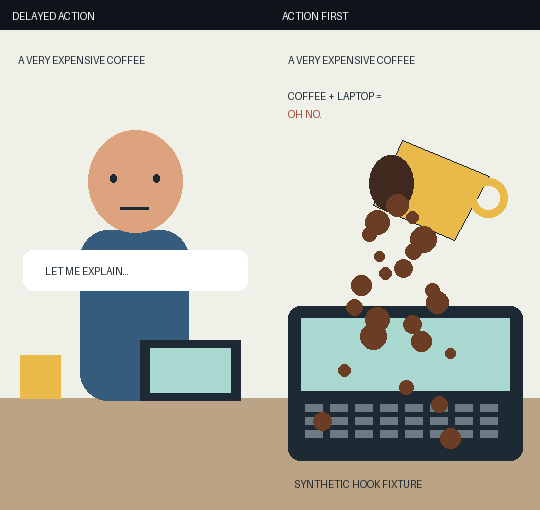

# hookcheck

**Will viewers swipe your Short in the first second?** Audit the actual opening frames of Shorts, Reels and TikToks, then get a risk verdict and concrete edits to try.

Requires **Python 3.9+**, [pipx](https://pipx.pypa.io/stable/installation/) and **ffmpeg 5+ / ffprobe** on `PATH`. Install in one command:

```sh
pipx install git+https://github.com/itzjk/hookcheck
```

(From a clone, `pipx install .` does the same.)

Then audit a video:

```sh
hookcheck examples/delayed-action.mp4 --strip opening.png
```

Real output from the included synthetic demos, without AI (excerpts):

```text
HIGH swipe risk | delayed-action.mp4
Basis: measurements_only (editing heuristic, not a swipe prediction)
  The opening barely changes across the first 1.5 seconds.
  First detected cut: 3.000s
  Try starting at 3.000s, where a later 0.5s window has more visual activity.

LOW swipe risk | action-first.mp4
Basis: measurements_only (editing heuristic, not a swipe prediction)
  Visual activity is present from the opening.
  Opening motion (0-1.5s): 0.0289 (0-1 pixel difference)
```



The left clip announces a problem before showing it. The right clip starts with coffee spilling onto a laptop. These are reproducible test animations, **not measured audience outcomes**. Full real reports: [delayed action](examples/delayed-action.txt), [action first](examples/action-first.txt). Videos: [delayed action](examples/delayed-action.mp4), [action first](examples/action-first.mp4).

No accounts or API keys required. **By default, analysis is offline.** With a local Ollama vision model, interpretation stays local too. Selecting Anthropic or OpenAI explicitly sends the sampled JPEG frames to that provider, never the video or audio file.

## Use

```sh
hookcheck examples/action-first.mp4
hookcheck examples/delayed-action.mp4 --json
hookcheck examples/delayed-action.mp4 --json --strip opening.png > report.json
```

`--strip` saves the four opening samples plus two samples of the proposed alternative start, if found. Every frame is labeled with its seek target in seconds. Short clips include only timestamps that exist. The input file cannot be overwritten by the strip.

JSON includes `schema_version`, `risk`, `risk_basis`, `reasons`, `fixes`, `measurements`, `vision`, `ocr`, `frames`, and measured `elapsed_s`. Missing measurements are `null`. Exit status is `0` for a report, including high risk or unavailable vision, and `2` for invalid input or a processing failure. `--json` errors also use JSON.

For a one-off run without installing, with [uv](https://docs.astral.sh/uv/):

```sh
uvx --from git+https://github.com/itzjk/hookcheck hookcheck video.mp4
```

Not on PyPI yet, so `pipx install hookcheck` (without the URL) does not work.

## Add vision

Choose the provider explicitly with `HOOKCHECK_PROVIDER`. Existing API keys alone never enable uploads.

| Provider | Environment | Default model | Frames leave this machine? |
| --- | --- | --- | --- |
| No AI | `HOOKCHECK_PROVIDER=none` (default) | None | No |
| Ollama | `HOOKCHECK_PROVIDER=ollama` | `qwen2.5vl:7b` | No, with a local model/server |
| Anthropic | `HOOKCHECK_PROVIDER=anthropic`, `ANTHROPIC_API_KEY` | `claude-sonnet-4-6` | Yes, to Anthropic |
| OpenAI | `HOOKCHECK_PROVIDER=openai`, `OPENAI_API_KEY` | `gpt-4.1-mini` | Yes, to OpenAI |

`HOOKCHECK_MODEL` overrides the model. A vision-capable model is required. For Ollama, install the model and start the server using its [setup guide](https://docs.ollama.com/quickstart) and [vision guide](https://docs.ollama.com/capabilities/vision). `OLLAMA_HOST` defaults to `http://127.0.0.1:11434`; only loopback HTTP endpoints are accepted. hookcheck checks `/api/show` before sending images and refuses remote models, aliases to remote models, and models without vision capability. It does not download models. To disable cloud features in the Ollama server itself, follow [Ollama's local-only configuration](https://docs.ollama.com/faq#how-do-i-disable-ollamas-cloud-features).

The model sees opening samples at **0, 0.5, 1 and 1.5 seconds**, followed by the alternative-start samples when available. It describes the opening, distinguishes visible action from talking/posing, reads visible text and checks whether the candidate actually shows action. A rejected candidate is not recommended. Responses are schema-checked; missing keys, provider errors, timeouts and malformed responses preserve the local measurements and explain that vision is unavailable. There are no automatic paid retries.

Provider payloads are tested with fakes, including a real loopback HTTP server. **Live Anthropic, OpenAI and Ollama model inference has not been verified in this checkout.** Model availability and inference quality can change. Cloud requests have a 45-second socket timeout; model startup may exceed it.

## What is measured

| Signal | Method | What it does not establish |
| --- | --- | --- |
| Opening visual change | FFmpeg downsamples to 160 x 90 grayscale at 8 fps; mean absolute pixel difference, divided by 255, over 0-1.5 s | Object motion, emotion or narrative meaning |
| Black first frame | At least 98% of pixels in the actual first decoded frame have luma <= 20/255 | Whether a dark scene is intentional |
| Low-detail first frame | First-frame luma standard deviation < 4/255 | Semantic emptiness; a title card can be meaningful |
| First cut | FFmpeg `scdet`, threshold 12, at the source frame rate throughout the video | Flashes and rapid movement can trigger false cuts |
| First sound | FFmpeg `silencedetect`, -35 dB, minimum silence 0.05 s; first audio stream, preserving its offset from video | **Speech onset is not verified.** Music/noise can trigger it; `voice_onset_s` is always `null` |
| On-screen text | Local Tesseract, if present on `PATH`; otherwise optional vision | OCR and model transcriptions can be wrong |
| Alternative start | Highest-activity later 0.5 s window, sampled every 0.125 s; must exceed 0.008 and be at least 1.5x opening activity | A better story beat or a safe sentence boundary |

These are **implementation thresholds**, not research-derived retention benchmarks. The source cut detector operates before frame-rate resampling. The first-frame check uses an independent seek to zero so a single black source frame cannot disappear in motion sampling. Frame labels are seek targets, not certified presentation timestamps, particularly for variable-rate footage. Rotation is handled by FFmpeg's default autorotation; tiny text may be lost in the 512-pixel vision samples.

The risk rule is deliberately inspectable in [audit.py](src/hookcheck/audit.py): black adds 3 points; low detail adds 2; motion below 0.005 adds 2, below 0.015 adds 1; no detected sound or a sound delay beyond 0.5 s adds 1. An insufficient motion sample adds 1. Zero points means low, one means medium, two or more means high. Vision showing action in frame zero removes 2 points unless the frame is black. Talking/posing without visible action makes risk at least high; other openings without visible action make it at least medium. **Risk is a heuristic, not a calibrated swipe probability.** A still image can be a great hook and camera shake can fool the motion score. Vision descriptions remain inferences.

Processing is bounded to videos with known duration up to 10 minutes. The full video is scanned for the alternative, so runtime grows with resolution, codec and duration. FFmpeg processes have a 120-second timeout. Grayscale samples are held in a temporary file (about 69 MB maximum at the duration limit), rather than keeping full video frames in memory. Files are cleaned up after analysis. No telemetry, accounts, transcripts, automatic edits or uploads beyond the explicitly selected vision provider.

## Why this exists

A strong opening line does not guarantee that the viewer can **see** the stakes. YouTube measures [how many viewers chose to view versus swiped away](https://support.google.com/youtube/answer/12942217?co=YOUTUBE._YTVideoType%3Dshorts&hl=en). That makes the first visible beat worth checking separately from the script.

The motivating creator observation, reported in October 2026, was 64% swiped away for a seated talking opening, versus 28-30% for openings that showed the accident from frame zero in the same series. The underlying analytics are not public and were not independently verified here. This is a reason to investigate, **not evidence of causality or a calibration dataset**. The 1.5-second audit window is an editing choice, not a universal platform threshold.

Related work, reviewed October 27, 2026:

- [claude-youtube](https://github.com/AgriciDaniel/claude-youtube) covers hooks, scripts, analytics and creator workflows. hookcheck starts from a local video file and produces a fixed report.
- [DDaverse's hook analyzer](https://github.com/ddaverse/shorts-reels-hook-analyzer) describes script and hook optimization. Its public repository contains a README rather than a comparable local video CLI.
- [claude-video-vision](https://github.com/jordanrendric/claude-video-vision) already extracts real frames and measures video structure. Its README describes a general perception layer for Claude Code, while hookcheck packages a specific opening audit, risk rule, alternative start and scriptable JSON into one command.

Video-frame analysis already exists. The useful distinction here is the focused audit and local-model path, not a claim to have invented it. No comprehensive market survey or “first ever” claim is made.

Technical sources: [FFmpeg filters](https://ffmpeg.org/ffmpeg-filters.html#scdet), [silence detection](https://ffmpeg.org/ffmpeg-filters.html#silencedetect), [Ollama vision](https://docs.ollama.com/capabilities/vision), [Anthropic vision](https://platform.claude.com/docs/en/build-with-claude/vision), [OpenAI image input](https://developers.openai.com/api/docs/guides/images-vision). Consulted October 27, 2026.

## Develop and test

In a Python virtual environment, install the checkout:

```sh
python -m pip install .
```

For editable development, use `python -m pip install -e .`. Both installation modes support pip 21.2.4 on Python 3.9; upgrading pip is not required. Package metadata stays in `pyproject.toml`, with `setup.py` providing compatibility for older editable installers. The build dependency is bounded to setuptools 64-79 to support both legacy editable installation and modern editable wheels; [setuptools 80 changed the legacy develop command](https://setuptools.pypa.io/en/stable/history.html#v80-0-0). This bound applies only to the isolated build environment.

Run all tests with one command:

```sh
python -m unittest discover -s tests -v
```

Tests generate real MP4s with FFmpeg: stationary versus moving footage, delayed action, a single black first frame, silent audio, delayed audio and stream offsets. They assert the risk direction, candidate timestamp, cut and onset times, actual JPEG inputs to fake vision, JSON/PNG CLI output, and graceful failure. HTTP tests check the three provider payloads, local transport, cloud rejection, redirects and HTTP 200 error bodies. Inverting the high/low verdict makes the static/moving regression test fail.

CI runs the suite on every push and pull request with Python 3.9 and 3.13, installing system FFmpeg. A separate job installs in editable mode with pip 21.2.4 on Python 3.9 to catch legacy installer regressions. The tests require an FFmpeg build with the `libx264` encoder. For optional local OCR, install Tesseract separately. Live OCR was not exercised when producing the demo reports.

Regenerate the synthetic videos and comparison GIF:

```sh
python examples/generate.py
```

Capture full reports and strips again:

```sh
HOOKCHECK_PROVIDER=none hookcheck examples/delayed-action.mp4 --strip examples/delayed-action.png > examples/delayed-action.txt
HOOKCHECK_PROVIDER=none hookcheck examples/action-first.mp4 --strip examples/action-first.png > examples/action-first.txt
```

The examples contain an illustration and a synthetic tone, not a voice track. Their reports measure sound onset; no speech claim is made. Codec versions can slightly change pixel-difference values.

## License

[MIT](LICENSE), including the synthetic example assets.
