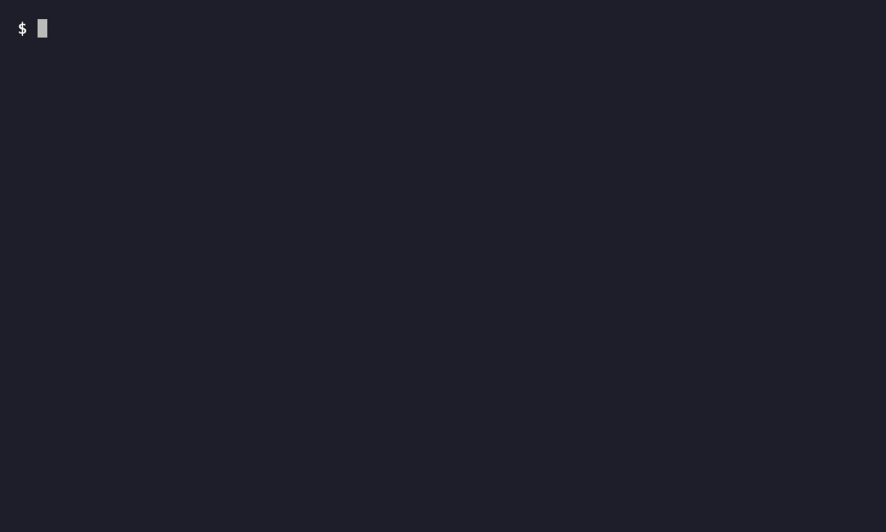

# hookcheck

Find the opening frames that give viewers a reason to swipe, and where to start instead.

[](https://github.com/itzjk/hookcheck/actions/workflows/tests.yml)
[](LICENSE)



## Quick start

Requires Python 3.9+, [pipx](https://pipx.pypa.io/stable/how-to/install-pipx.html), Git, and [FFmpeg 5+](https://ffmpeg.org/download.html) with `ffprobe` on your `PATH`.

```sh
pipx install git+https://github.com/itzjk/hookcheck
```

Point it at your local video:

```sh
hookcheck video.mp4
```

## Features

- Get a low, medium or high swipe-risk verdict with reasons and up to three edits to try.
- Catch a black first frame, a static opening, late sound and the first detected cut.
- Find a later burst of visual activity to consider as your new opening.
- Save a labeled frame strip, or feed the JSON report into your own scripts.
- Run offline without AI, or add visual interpretation with local Ollama, Anthropic or OpenAI.

## Why

YouTube tracks [viewed versus swiped away](https://support.google.com/youtube/answer/12942217?co=YOUTUBE._YTVideoType%3Dshorts&hl=en), but a strong opening line does not guarantee the stakes are visible.
The motivating creator comparison reported 64% swiped away for a seated talking opening versus 28–30% for accident-first openings in the same series; these were private, observational analytics, documented with the [evidence and related tools](docs/evidence.md).
hookcheck checks the video file itself and gives you a specific opening to compare in your next edit.

## How it works

FFmpeg measures visual change over the first 1.5 seconds, first-frame brightness and detail, scene cuts, and sound onset, then scans the video for a more active half-second window. Optional vision examines frames at 0, 0.5, 1 and 1.5 seconds plus candidate frames: is the problem already visible, or is someone announcing it? Local Tesseract reads screen text when installed. The report combines these signals into an inspectable editing heuristic; it leaves your video untouched. See the [measurement rules](docs/reference.md) for thresholds and the JSON format.

## Usage

| Command | Result |
| --- | --- |
| `hookcheck video.mp4` | Verdict, measurements and suggested edits |
| `hookcheck video.mp4 --json` | JSON report on stdout |
| `hookcheck video.mp4 --strip opening.png` | Report plus a labeled PNG strip |
| `hookcheck video.mp4 --json --strip opening.png > report.json` | Both artifacts in one pass |
| `hookcheck --help` | Available options |
| `hookcheck --version` | Installed version |

The demo compares two six-second synthetic coffee-spill clips. The delayed opening gets **HIGH** risk and a **3.000s** alternative start; the action-first version gets **LOW** risk. Watch the [delayed clip](examples/delayed-action.mp4) and [action-first clip](examples/action-first.mp4), or read their full [delayed](examples/delayed-action.txt) and [action-first](examples/action-first.txt) reports. The [side-by-side animation](examples/comparison.gif) shows what changes between them.

## FAQ

**Does my video leave my machine?**

The default analysis is offline. Ollama uses a locally installed vision model through a loopback server. Selecting Anthropic or OpenAI sends sampled JPEGs to that provider; the video and audio files stay local. Existing API keys alone never enable uploads.

**How do I enable vision?**

Set `HOOKCHECK_PROVIDER` to `ollama`, `anthropic` or `openai`. Cloud providers also need their API key. `HOOKCHECK_MODEL` overrides the default model. Follow the [provider setup](docs/reference.md#vision-providers) for models and Ollama configuration. Missing credentials or a failed provider leave the measured report available.

**Does it work with Reels and TikToks?**

Yes. Use a local file that FFmpeg can decode, with a known duration up to ten minutes. No platform login or account connection is needed.

**Will a low-risk opening get more views?**

The verdict identifies editing signals, not a predicted swipe percentage. Compare the suggested opening against your original using your platform analytics.

## Limitations

- Camera shake and flashes count as motion; a still image can still be a strong hook.
- Sound onset includes music and noise. It does not identify when speech starts.
- Suggested starts need a continuity check before cutting; vision and OCR can misread a frame.
- Scanning the whole video takes longer for longer or higher-resolution files. Live model inference remains unverified.

## Contributing

See [development setup](docs/development.md), then run the FFmpeg fixtures and fake-provider tests with `python -m unittest discover -s tests -v`.

## License

[MIT](LICENSE), including the synthetic example assets.
